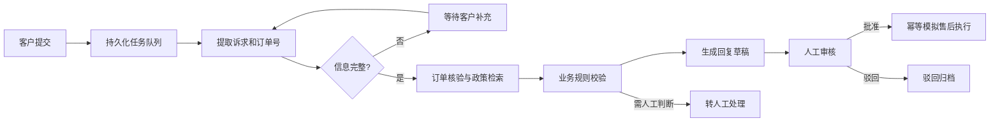

# FlowDesk · AI 售后工单工作流平台

将客户描述转化为可审核、可追踪的售后处理流程。使用 **FastAPI + LangGraph + DeepSeek + SQLite**，串联诉求识别、订单核验、政策检索、回复草稿、人工审批与模拟售后执行，提供客户、客服和管理员工作台。

当前版本 **v0.2.0**。支持无需密钥的离线演示，以及使用真实模型的完整流程。订单、政策和售后操作均为合成演示场景，不连接真实电商、退款或物流系统。

## 功能亮点

- **可恢复工作流**：LangGraph 检查点保存进度，缺少信息时等待客户补充，生成草稿后等待人工审核。
- **登录与权限**：首次启动创建管理员，无预置密码；客户只访问自己的订单和工单，客服负责审核，管理员管理账号与演示批次。
- **持久化后台任务**：提交接口返回 HTTP 202，后台线程领取任务、续租、失败重试，重启后接管租约过期的任务。
- **业务约束与幂等**：代码校验订单归属、签收和申请期限，数据库唯一约束避免重复创建模拟售后单。
- **政策检索与审计**：按业务类型过滤后进行 BM25 检索，展示政策来源、版本、审核记录和处理过程。
- **可复现演示**：生成 200 条合成工单，覆盖退换货、物流、补充信息、人工处理与驳回；批次离线执行，不消耗模型额度。

## 工作流程



## 快速开始

已在 **Windows / Python 3.14.7** 验证。建议使用 Python 3.14 和锁定依赖复现环境。

```powershell
git clone https://github.com/Lobbyewqs/FlowDesk.git
cd FlowDesk
powershell -NoProfile -ExecutionPolicy Bypass -File .\setup.ps1
Copy-Item .env.example .env
powershell -NoProfile -ExecutionPolicy Bypass -File .\start.ps1
```

打开 [本地工作台](http://127.0.0.1:8765)，首次访问设置管理员账号和密码。安装后也可以双击 `启动FlowDesk.cmd`；端口冲突时使用 `start.ps1 -Port 8767`。

管理员可创建客服或客户账号；客户可绑定合成客户 `C001` 或 `C002`。仓库没有默认账号或密码。先在浏览器登录，再访问 `/docs` 调试受权限保护的接口。

其他系统可创建虚拟环境，安装 `requirements.lock.txt`，再运行 `python run.py`；跨系统运行尚未实测。

## 接入 DeepSeek

默认 `demo` 模式使用规则识别与模板回复，无需联网。需要真实模型时，在本机 `.env` 中设置：

```dotenv
FLOWDESK_MODE=live
FLOWDESK_BASE_URL=https://api.deepseek.com
FLOWDESK_MODEL=deepseek-flash
FLOWDESK_API_KEY=
FLOWDESK_DATA_DIR=data
```

将密钥填写在本机 `FLOWDESK_API_KEY` 后，确认模型名在自己的供应商账号下可用，再重启服务。环境变量优先于 `.env`。真实调用产生供应商用量；演示批次始终使用 `demo`。

密钥仅保存在本机；不要提交 `.env`、运行数据库或含客户内容的报告。`.env.example` 提供空配置。

## 角色与权限

| 角色 | 主要权限 |
| --- | --- |
| 客户 | 查看自己的订单和工单，提交诉求、补充信息；不可查看内部草稿和审计 |
| 客服 | 查看工单与任务，代客提交、审核、驳回、重试 |
| 管理员 | 客服权限，以及创建/停用账号、导入演示批次 |

权限在服务端校验，列表、统计和详情均限制数据归属。密码使用随机盐与 PBKDF2-HMAC-SHA256；服务端仅保存会话令牌哈希，浏览器使用 HttpOnly / SameSite Cookie。详见[架构说明](docs/architecture.md)。

## 演示与验证

在管理员工作台导入 200 条演示工单，或停止服务后使用命令行生成并运行模拟客服操作：

```powershell
.\.venv\Scripts\python.exe scripts/seed_demo.py
# --new 额外创建一个批次；默认复用已有批次
.\.venv\Scripts\python.exe -m pytest -q
.\.venv\Scripts\python.exe evaluate.py
```

`fixtures/evaluation.json` 含 24 条合成标注样本，评估意图、状态与政策命中。离线评估检查演示逻辑，不能说明真实模型准确率。

```powershell
# 可选：先配置 live；会产生模型用量
.\.venv\Scripts\python.exe scripts/verify_live.py
```

真实验收覆盖补充信息、审批、驳回、业务执行和恢复，使用隔离数据目录。报告只保存在本地。详见[测试说明](docs/testing.md)。

## 项目结构

```text
flowdesk/              API、认证、业务存储、后台任务与 LangGraph 工作流
static/                HTML / CSS / JavaScript 工作台
fixtures/              合成政策与评估样本
scripts/               演示批次与真实模型验收工具
tests/                 权限、工作流、任务恢复及幂等测试
docs/                  架构与测试说明
requirements.lock.txt  已验证环境的锁定依赖
```

## 工程边界

这是单进程、两个后台执行线程的本地应用，使用 SQLite WAL 存储业务数据，独立 SQLite 保存图检查点。当前不提供分布式执行、多实例一致性、真实退款或生产吞吐保证；每订单仅允许一个模拟售后单。公网部署还需完善 HTTPS、运维监控、备份、迁移与部署加固。

200 条工单用于功能演示；小样本模型验收用于验证流程可运行，不作为生产性能或业务准确率承诺。
