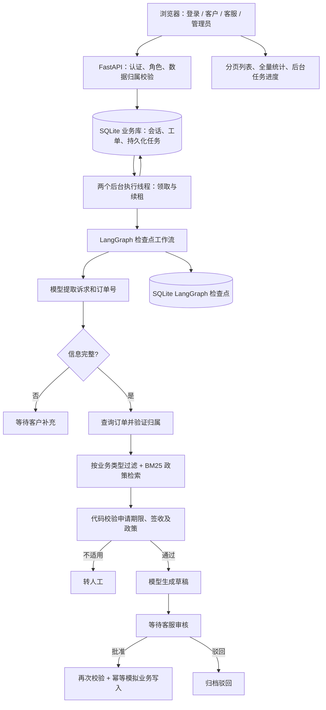

# FlowDesk v0.2 架构

## 登录与权限

首次初始化在写事务中确认账号表为空，再创建管理员；初始化完成后不再开放此入口。没有默认密码或匿名角色切换。用户名唯一；随机盐 + PBKDF2-HMAC-SHA256（600,000 次）保存密码。

随机会话令牌仅通过 HttpOnly / SameSite=Strict Cookie 保存于浏览器，数据库保存 SHA256 哈希与八小时有效期。生产 HTTPS 下 Cookie 设置 Secure，本地 HTTP 不设置该标记。退出删除会话，账号停用删除其所有会话；请求时重新读取账号角色和启用状态。登录按用户名与来源地址限制连续失败次数，密码字段和验证错误不回显原输入。

客服和管理员可以处理全部演示工单；客户绑定 C001/C002，只能查询和补充归属于该客户的工单。其他客户工单详情返回 404。客户不可审批、重试或查询任务/账号管理接口；客户接口不返回未审核草稿、内部审计和审批备注。列表与统计均在数据库查询时施加客户范围，避免只在页面隐藏数据。

浏览器写操作校验 Origin / Sec-Fetch-Site；退出或切换账号时清空页面业务缓存，旧登录周期的异步响应不再更新页面。当前身份在接口入口检查，已接收的后台任务按接收时的授权继续执行；停用账号不自动撤回已入队操作。

## 持久化任务

工单初次提交与 `start` 任务在同一事务落库，接口返回 202。补充、审批和重试任务先检查当前状态与权限，再写队列。任务表的部分唯一索引阻止同工单存在两个 queued/running 任务。

领取任务使用 `BEGIN IMMEDIATE`，写入 owner、attempts 和 45 秒 lease_until；执行线程旁的心跳线程约每 15 秒续租。两个线程可并行处理不同工单，同工单继续使用进程内互斥锁。数据库写冲突等待由 SQLite 处理。

任务状态为 `queued → running → done`；执行失败且尝试不足三次时延迟 1 / 2 秒重新排队，达到上限进入 failed。租约过期的 running 任务可被接管，并消耗一次尝试机会。任务记录的 owner 防止旧领取者覆盖新领取者的结果。

正常停止先停止领取新任务，再等待执行中的任务结束并关闭数据库。崩溃或强制结束后，待处理任务仍在磁盘；重新启动并等待租约过期即可接管。运行期间续租避免普通长任务被重复领取。

这是单进程两个工作线程的持久化队列，并非 Celery、分布式任务系统或跨实例执行保证。多进程场景还需分布式互斥与图状态并发控制。

## 检查点与业务幂等

LangGraph 使用工单 ID 作为 thread_id，独立的 `checkpoints.sqlite3` 保存进度，`business.sqlite3` 保存业务表。工作流返回后将状态投影到工单表；有活动任务时详情读取直接返回已持久化的业务投影，避免等待模型节点释放工单锁。

等待输入使用 interrupt；输入任务记录暂停点 ID。任务接管时，如果原暂停点已消费并进入新暂停点或终态，就不会再次提交旧输入；失败在普通执行节点时从检查点继续。

模拟售后表对 ticket_id 和 order_id 分别建立唯一约束。写事务中先检查已有记录，再创建售后单；若写入成功后图检查点尚未写入，恢复时先返回已有结果。每订单仅一个售后单是首版业务简化，不是完整订单行/数量售后模型。

## 数据与模式

新增表：users、sessions、login_attempts、jobs、demo_batches、demo_cases；tickets 增加 batch_id 和客户/状态索引，原有数据保留。使用 WAL、外键与参数化 SQL。金额按整数分存储，时间保存 UTC，浏览器按本机时区显示。

普通新工单的运行模式由配置确定；批次导入固定 demo。任务根据工单自身模式选择图执行器，不会因为全局配置是 live 而对 200 条演示工单调用模型。DeepSeek 密钥不进入图状态、任务 payload、HTTP 元数据或配置对象表示。

政策固定在 fixtures/policies.json，按类型过滤并用中文二元组 BM25 检索，保留版本及来源。模型只负责理解和组织回复；确定性规则处理订单归属、签收和期限。没有向量模型或向量数据库。

演示订单的签收日期只在首次生成时确定，长期使用可能自然超期。需要新数据时可以新增演示批次；不要只删除其中一个数据库。数据迁移前备份两个数据库，停止服务后使用本地 CLI 导入。

## 验证边界

合成工单批次与真实模型验收分别统计。小样本用于功能检查，不代表真实业务准确率或生产吞吐量。当前不包含分布式队列或多实例执行保证。仓库不分发本地数据库、账号、会话与运行报告。
